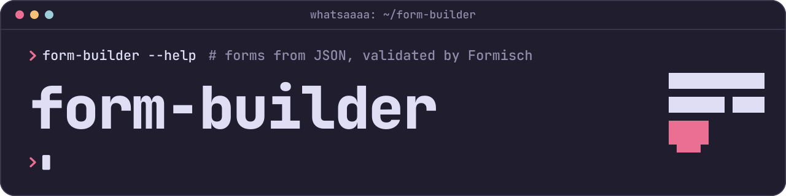

# form-builder-sample

Two small apps built with [form-builder](https://whatsaaaa.github.io/form-builder/) `1.0.0-rc.0`, using only what a new user has: the documentation site and the packages on npm. The repository is the release-candidate trial for form-builder 1.0: it shows that real forms can be built from the public material, and records every problem met on the way. The apps take their look from the [Whatsaaaa design system](https://github.com/whatsaaaa/design-system), installed from npm as `@whatsaaaa/design-system` like any other package.

**The record of the trial is [FRICTION-LOG.md](FRICTION-LOG.md).** Start there if you work on form-builder.

## The apps

| App                                                | What it is                               | What it exercises                                                                                                                                                             |
| -------------------------------------------------- | ---------------------------------------- | ----------------------------------------------------------------------------------------------------------------------------------------------------------------------------- |
| [`vue-event-registration`](vue-event-registration) | A multi-step event registration in Vue   | Steps, rows, a section and a slot, conditional fields and a conditional step, a repeating guest list, form rules, a definition loaded from a JSON file                        |
| [`react-checkout`](react-checkout)                 | A checkout in React, with a small server | A definition served by the server and validated again there, messages in English and German, a repeating list of items, conditional fields, server errors shown on the fields |

Each app is self-contained: its own `package.json`, lockfile and tooling. Both need pnpm 11, and Node 22.18 or a later 22, or Node 24.12 or later, as the design system does.

Everything visual lives in each app's `src/ui` folder (field, layout and page components) and its one stylesheet, `src/styles.css`, so a restyle swaps those and leaves the forms alone. Both apps are restyled on the design system: their page is the system's terminal frame, with a tab bar, a status line that switches the theme and the shortcut keys, and a dark and a light theme.

## Run the Vue app

```sh
cd vue-event-registration
pnpm install
pnpm dev        # http://localhost:5173
```

## Run the React app

```sh
cd react-checkout
pnpm install
pnpm dev        # the app on http://localhost:5173, the API on http://localhost:8787
```

`pnpm dev` starts the API server and Vite together, and Vite passes `/api` on to the server. To run the production build the way the end-to-end tests do, with one server for the app and the API:

```sh
pnpm build
pnpm start      # http://localhost:8787
```

## Checks

The same commands work in both apps, and CI runs them all for both on every pull request and on `main`:

```sh
pnpm lint       # the linter, and Prettier
pnpm typecheck  # strict TypeScript
pnpm test       # unit tests, with Vitest
pnpm build
pnpm test:e2e   # end-to-end tests in a browser, with Playwright
```

The end-to-end tests need a browser once: `pnpm exec playwright install chromium`.

## Where things are

```
vue-event-registration/
  src/registration/   the definition (JSON), the builder, the form and its review summary
  src/ui/             field, layout and page components
  e2e/                end-to-end tests

react-checkout/
  shared/             the definition, the builder, the catalog and the texts: used by browser and server
  server/             the API: serves the definition, validates and prices orders
  src/checkout/       the form and its calls to the API
  src/ui/             field, layout and page components
  e2e/                end-to-end tests
```

## License

[MIT](./LICENSE).
